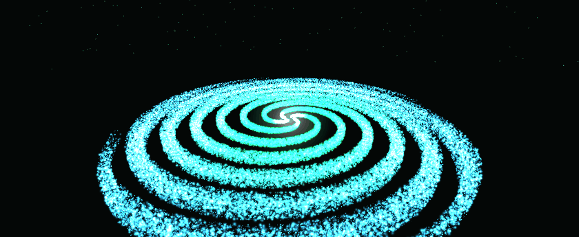
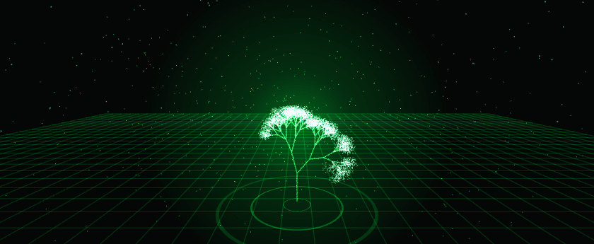
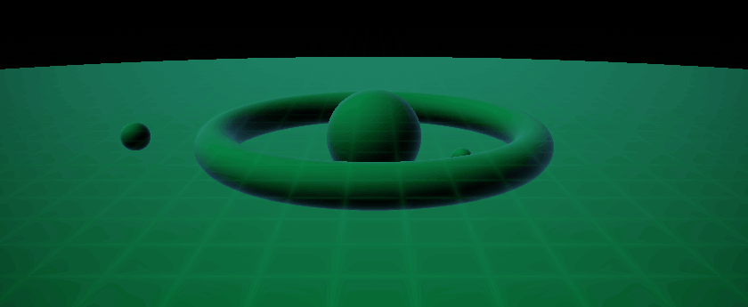
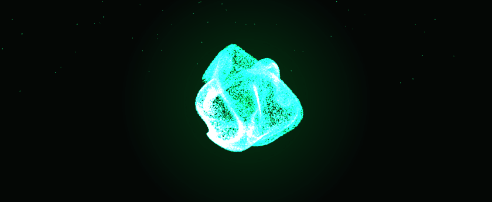
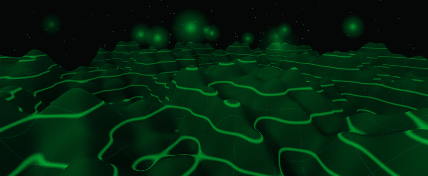
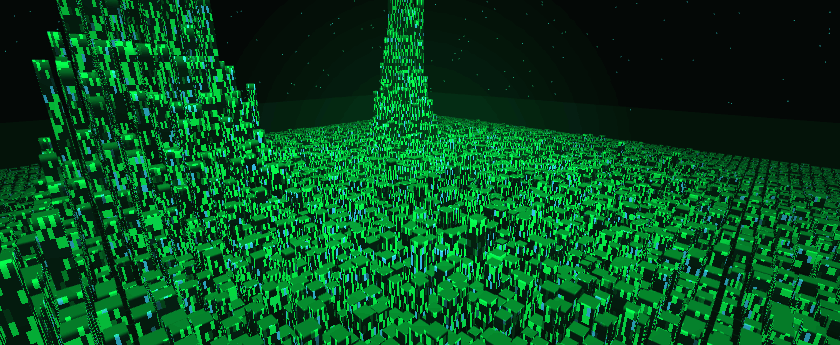
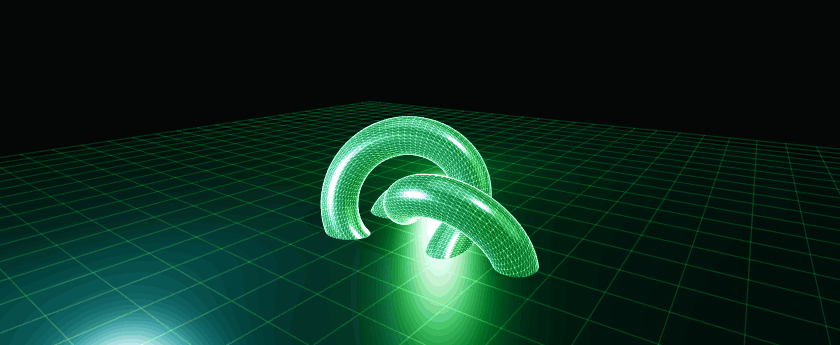
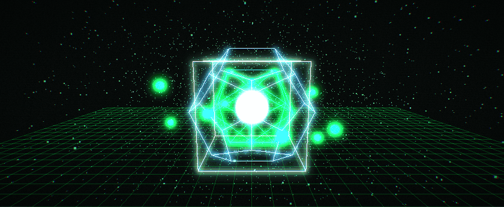

<div align="center">



<h1>GPU LAB</h1>

<p><b>Ocho escenas 3D que se calculan enteramente dentro de la tarjeta gráfica.</b><br>
Partículas, raymarching, simulación GPGPU, terreno procedural, instancing, PBR y una cadena de post-proceso propia.</p>

<p>
  
  
  
  
  
  
</p>

<p><i>119–120 FPS · 0,07 a 0,48 ms de GPU por fotograma · menos del 6 % del presupuesto de 8,33 ms</i></p>

</div>

---

## 📖 Índice

- [Qué es esto](#-qué-es-esto)
- [Las ocho demos](#-las-ocho-demos)
- [Rendimiento medido](#-rendimiento-medido)
- [Estructura del repositorio](#-estructura-del-repositorio)
- [Cómo ejecutarlo](#-cómo-ejecutarlo)
- [Pipeline de captura de los GIF](#-pipeline-de-captura-de-los-gif)
- [Créditos y licencia](#-créditos-y-licencia)

---

## 🎯 Qué es esto

Un laboratorio de **render en tiempo real sobre GPU**. Cada escena de este repositorio está
pensada para poner a trabajar una parte distinta de la tarjeta gráfica: el vertex shader, el
fragment shader, el *blending*, los búferes de fotograma flotantes, el *instancing*, los mapas
de sombra o los pases de post-proceso.

Todo está escrito a mano —geometría, matrices, shaders y el motor que los orquesta— sin motores
ni frameworks más allá de **Three.js** para el contexto WebGL. No hay ninguna animación
pre-renderizada en las demos: lo que ves son fotogramas calculados en vivo.

El objetivo doble del proyecto:

1. **Demostrar** técnicas reales de GPU con código legible y comentado en español.
2. **Medir** lo que cuestan, con el cronómetro de GPU del propio navegador
   (`EXT_disjoint_timer_query_webgl2`), no con estimaciones.

---

## 🎬 Las ocho demos

### 01 · Árbol neón — nube de puntos y mezcla aditiva



Árbol generado por **recursión** (ramas como líneas y follaje como 5 928 puntos) con mezcla
aditiva, 420 luciérnagas animadas y anillos de radar expansivos.

> **En la GPU:** 5 928 puntos + 434 triángulos, `blending` aditivo y atenuación de tamaño.

### 02 · Galaxia de partículas — cómputo en el vertex shader


**180 000 estrellas** distribuidas en cuatro brazos espirales. Las posiciones no se recalculan
en JavaScript: el *vertex shader* recibe radio, ángulo y semilla por atributo y resuelve la
rotación diferencial (más rápida en el núcleo) fotograma a fotograma.

> **En la GPU:** 180 000 invocaciones de vertex shader por fotograma ≈ **21,6 millones por segundo**.

### 03 · Raymarching SDF — sin geometría



Ni un solo triángulo: una única superficie que cubre la pantalla y un *fragment shader* que
recorre la escena con **sphere tracing** (suelo, toro, núcleo y tres satélites), acumulando un
halo volumétrico y calculando normales por diferencias finitas.

> **En la GPU:** ~100 pasos × 841 000 píxeles ≈ **84 millones de evaluaciones de SDF por fotograma**.

### 04 · Partículas GPGPU — simulación dentro de la GPU



**65 536 partículas** cuyo estado vive en cuatro texturas flotantes de 256² en *ping-pong*: un
shader calcula las velocidades (muelle esférico, remolino y turbulencia senoidal) y otro integra
las posiciones. El dibujo lee la textura desde el *vertex shader* con *vertex texture fetch*.
El procesador no toca ni un solo dato de la simulación.

> **En la GPU:** 2 pases de simulación por paso + 65 536 vértices que leen una textura RGBA32F.

### 05 · Terreno procedural — desplazamiento en el vertex shader



Una malla plana de **78 400 vértices** que se convierte en cordillera: el *vertex shader* calcula
la altura con funciones seno/coseno cuyas fases son múltiplos enteros de un ángulo que completa
2π por ciclo, obtiene la normal por diferencias finitas y el *fragment shader* dibuja curvas de
nivel topográficas, rejilla y niebla atmosférica.

> **En la GPU:** 78 400 vértices × 3 evaluaciones de altura + 155 700 triángulos por fotograma.

### 06 · Ciudad instanciada — miles de edificios en una llamada



**8 100 edificios** con **una sola llamada de dibujo** (*instanced rendering*): la misma caja
repetida con matrices y atributos por instancia. Las ventanas, el degradado, el parpadeo y la
onda de energía que recorre la ciudad se calculan por fragmento.

> **En la GPU:** 97 204 triángulos y 8 100 instancias por fotograma a través de **1 draw call**.

### 07 · Visor de modelos — PBR, sombras y entorno



Tres modelos procedurales (nudo toroidal, icosaedro facetado y un racimo de cristales) con
materiales **PBR** (metalicidad / rugosidad), **mapas de sombra** de 2048² y un **entorno
prefiltrado con PMREM** generado en la GPU para que los reflejos sean físicamente coherentes.
Se puede girar, acercar, cambiar de modelo y superponer la malla de alambre.

> **En la GPU:** PBR + pase de sombras 2048² + prefiltrado especular PMREM.

### 08 · Bloom y post-proceso — seis pases propios



La escena no se dibuja directamente en pantalla: pasa por un búfer **HDR half-float**, un pase
de brillo, dos desenfoques gaussianos separables (a media y a un cuarto de resolución) y un pase
final con aberración cromática radial, líneas de barrido, grano y viñeta.

> **En la GPU:** 6 pases de pantalla completa sobre 841 000 píxeles por fotograma.

---

## 📊 Rendimiento medido

Medido en el equipo de desarrollo con el cronómetro de GPU del navegador, a 949 × 886 píxeles
y 120 Hz (el informe completo está en [`docs/RENDIMIENTO.md`](docs/RENDIMIENTO.md)):

| # | Demo | GPU / fotograma | Draw calls | Geometría | FPS |
|---|---|---|---|---|---|
| 01 | Árbol neón | 0,07 ms | 9 | 5 928 pts · 434 tri | 120 |
| 02 | Galaxia de partículas | 0,20 ms | 3 | 180 000 pts | 120 |
| 03 | Raymarching SDF | 0,48 ms | 1 | 2 tri (todo en el shader) | 120 |
| 04 | Partículas GPGPU | 0,08–0,15 ms | 3 | 66 136 pts | 120 |
| 05 | Terreno procedural | 0,13–0,21 ms | 11 | 155 700 tri | 119 |
| 06 | Ciudad instanciada | 0,24–0,33 ms | 5 (1 para la ciudad) | 97 204 tri | 120 |
| 07 | Visor de modelos | 0,28 ms | 5 | 20 072 tri | 120 |
| 08 | Bloom y post-proceso | 0,18 ms | 1 + 6 pases | 2 tri | 120 |

```
presupuesto de fotograma a 120 Hz   ████████████████████████████████████████  8,33 ms
uso de GPU en el peor caso          █                                          0,48 ms
```

**Equipo:** AMD Radeon RX 9060 XT · WebGL 2.0 vía ANGLE/Direct3D 11 · 1920 × 1080 @ 120 Hz.

---

## 🗂 Estructura del repositorio

```
gpu-lab/
├── index.html                     Portada con la rejilla de demos y detección de la GPU
├── assets/
│   ├── css/lab.css                Hoja de estilo compartida (paleta neón)
│   ├── js/lab-core.js             Motor común: renderer, bucle, HUD, cronómetro de GPU,
│   │                              controles orbitales, utilidades y modo captura
│   └── gifs/                      Animaciones de este README
├── demos/
│   ├── 01-arbol-neon/
│   ├── 02-galaxia-particulas/
│   ├── 03-raymarching/
│   ├── 04-gpgpu-particulas/
│   ├── 05-terreno-procedural/
│   ├── 06-ciudad-instanciada/
│   ├── 07-visor-modelos/
│   └── 08-postproceso-bloom/
├── docs/
│   ├── RENDIMIENTO.md             Informe de uso de la GPU
│   └── PIPELINE.md                Cómo se generan los GIF
├── tools/
│   ├── capture.html               Arnés de captura determinista
│   ├── save.php                   Receptor de fotogramas (servidor local)
│   └── build-gifs.ps1             Une los PNG y produce los GIF
└── vendor/three.min.js            Three.js r128 (MIT)
```

### El motor compartido

Las ocho demos comparten `assets/js/lab-core.js`:

| Utilidad | Para qué sirve |
|---|---|
| `LAB.boot(opciones)` | Crea el renderer, la escena, la cámara, el bucle y el HUD |
| `LAB.gpuTimer(renderer)` | Cronómetro real de GPU con `EXT_disjoint_timer_query_webgl2` |
| `LAB.orbit(cámara, lona, objetivo)` | Controles orbitales propios (ratón, rueda y táctil) |
| `LAB.glowTexture(color)` | Textura de brillo radial generada en un `canvas` |
| `LAB.stars(n, radio)` | Caja de estrellas envolvente |
| `LAB.grid(tamaño, divisiones)` | Rejilla de suelo con mezcla aditiva |
| `LAB.rng(semilla)` | Generador aleatorio determinista (mulberry32) |

Y dos convenciones importantes:

- **Bucle perfecto:** cada demo declara un `period`; `update(t)` recibe siempre `t ∈ [0, period)`,
  así que la animación vuelve exactamente al punto de partida.
- **Modo captura:** con `?embed=1` el motor deja de usar `requestAnimationFrame` y espera a que
  el arnés le pida fotogramas concretos, de forma determinista.

---

## 🚀 Cómo ejecutarlo

**Lo más rápido:** abre `index.html` en el navegador. Todas las demos funcionan desde el disco
(los scripts son clásicos y no cargan ningún recurso externo).

Si prefieres servirlo por HTTP —o quieres usar el arnés de captura, que necesita PHP—:

```bash
# con PHP
php -S 127.0.0.1:8080

# o con Python
python -m http.server 8080
```

Y abre `http://127.0.0.1:8080/`.

Las demos se controlan con el ratón (arrastrar para orbitar, rueda para acercar). El panel
superior derecho muestra **FPS, milisegundos de CPU, milisegundos de GPU, resolución, número de
llamadas de dibujo, geometría procesada y el nombre real de la tarjeta gráfica**.

---

## 🎞 Pipeline de captura de los GIF

Los GIF de este README no se graban con una capturadora de pantalla: se renderizan
**fotograma a fotograma dentro de la GPU** a resolución fija y se codifican después.

```
  navegador                                   FFmpeg (CPU)
  ┌──────────────────────────────┐            ┌────────────────────────┐
  │ tools/capture.html           │            │ palettegen (112 col.)  │
  │   iframe 840×345             │            │ dither=none            │
  │   └ pide fotogramas 0…23     │  PNG       │ 12,5 fps               │
  │      a la demo               │ ────────▶  │ → assets/gifs/*.gif    │
  │      y sube el PNG a         │            └────────────────────────┘
  │      save.php                │
  └──────────────────────────────┘
```

El detalle está en [`docs/PIPELINE.md`](docs/PIPELINE.md). En resumen:

```powershell
# 1 · arranca el servidor
php -S 127.0.0.1:8080

# 2 · abre el arnés tantas veces como demos quieras capturar
#     http://127.0.0.1:8080/tools/capture.html?demo=02-galaxia-particulas&n=24&w=840&h=345

# 3 · une los PNG y genera el GIF
powershell -File tools/build-gifs.ps1 -All
```

---

## 🙌 Créditos y licencia

- Código, escenas y shaders: **[Luis Ángel Muñoz Márquez](https://github.com/luis06-op)**.
- [Three.js](https://threejs.org/) r128 — licencia MIT (incluida en `vendor/`).
- Mediciones hechas sobre una **AMD Radeon RX 9060 XT** con Windows 11 y ANGLE/Direct3D 11.

Este proyecto se distribuye bajo licencia **MIT**. Puedes usarlo, modificarlo y compartirlo
citando la autoría.

<div align="center">
<br>

<br><br>
<b>Todo lo que ves aquí se está calculando ahora mismo en tu tarjeta gráfica.</b>
</div>
